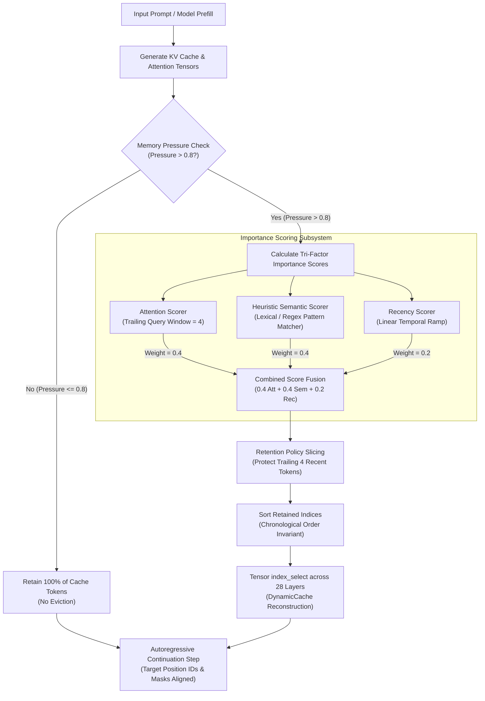

# Dynamic Semantic-Aware Attention (DSAA) — System Architecture

## 1. Project Overview

- **Project Name**: Dynamic Semantic-Aware Attention (DSAA)
- **Primary Objective**: Reduce Large Language Model (LLM) Key-Value (KV) cache memory consumption during autoregressive inference while preserving generation quality, without requiring model fine-tuning or retraining.
- **Approach**: Dynamic multi-signal token importance evaluation combining attention tensor reduction, heuristic lexical/structural pattern matching, and temporal recency, coupled with memory-pressure-gated retention and Hugging Face `DynamicCache` tensor compaction.

---

## 2. End-to-End System Pipeline

The DSAA inference and compaction workflow operates as a post-hoc intervention during transformer generation:



### Execution Flow Steps

1. **Prefill & State Extraction**:
   The input prompt is processed through the model with `output_attentions=True` and `use_cache=True`, producing the initial multi-layer KV-cache tensors and multi-head attention weights.
2. **Memory Pressure Evaluation**:
   Current token count $N$ is compared against maximum cache capacity. If pressure is $\le \text{pressure\_threshold}$ ($0.8$), the cache is untouched and generation proceeds immediately.
3. **Tri-Factor Importance Scoring**:
   When pressure exceeds the threshold, token utility is scored across three complementary dimensions (Attention, Semantic, Recency).
4. **Weighted Score Fusion**:
   Individual scores are normalized to $[0, 1]$ and combined via the verified default weighting:
   $$\text{CombinedScore} = 0.4 \cdot \text{Attention} + 0.4 \cdot \text{Semantic} + 0.2 \cdot \text{Recency}$$
5. **Retention Selection & Boundary Protection**:
   The lowest-scoring tokens are selected for eviction up to a maximum eviction fraction ($0.5$). The most recent tokens (`protected_recent_tokens=4`) are strictly immune from eviction to protect immediate syntactic continuity and local attention sinks.
6. **Chronological Sorting & Cache Compaction**:
   Retained token indices are sorted in their original relative sequence order. For each transformer layer, key and value tensors are sliced along the sequence dimension using `torch.index_select` and packaged into a reconstructed `DynamicCache`.
7. **Continued Generation**:
   Subsequent autoregressive generation proceeds against the compacted cache using updated attention masks and preserved absolute position IDs.

---

## 3. Core Algorithmic Subsystems

All algorithmic components are implemented in pure Python/PyTorch within the [`dsaa_algorithm/`](file:///Users/priyankak/DSAA/DSAA/dsaa_algorithm) package:

### 3.1 Attention Importance Scorer (`attention_score.py`)
- **Input**: 5D attention tensors `[layers, batch, heads, query, key]`.
- **Mechanism**: Attention weights are averaged across layers, batches, and attention heads. To focus on immediate context rather than distant queries, the scorer aggregates over a trailing query window ($W = 4$):
  $$\text{RawScore}(j) = \frac{1}{W} \sum_{q=-W}^{-1} \bar{A}_{q, j}$$
- **Normalization**: Min-max normalized to $[0, 1]$. Uniform attention edge cases safely return a zero vector.

### 3.2 Heuristic Lexical/Structural Semantic Scorer (`semantic_score.py`)
- **Design Classification**: A **fast heuristic rule-based pattern matcher**, *not* a learned neural embedding model or LLM judge.
- **Mechanism**: Maps tokenizer character offsets to predefined lexical and structural patterns:
  - Proper nouns / Title-case entities (`r"\b[A-Z][a-z]+(?:\s+[A-Z][a-z]+)*\b"`): Base score $0.9$
  - Numerical values & percentages (`r"\b\d+(?:\.\d+)?%?\b"`): Base score $0.9$
  - Domain keywords (`AI|ML|NLP|LLM|Python|PyTorch`): Base score $0.8$
  - Causal connectives (`important|because|therefore|must|should|requires`): Base score $0.7$
  - Default token baseline: $0.1$
- **Normalization**: Min-max normalized to $[0, 1]$ across all token positions.

### 3.3 Recency Scorer (`recency_score.py`)
- **Mechanism**: A normalized linear ramp giving higher weight to newer sequence tokens:
  $$\text{RecencyScore}(i) = \frac{i}{N - 1}, \quad i \in \{0, \dots, N-1\}$$
- **Edge Cases**: $N=0 \to \emptyset$, $N=1 \to [1.0]$.

### 3.4 Combined Score Integration (`combined_score.py`)
- **Formula**: $\text{Combined} = w_{\text{att}} S_{\text{att}} + w_{\text{sem}} S_{\text{sem}} + w_{\text{rec}} S_{\text{rec}}$
- **Verified Default Weights**: $w_{\text{att}} = 0.4$, $w_{\text{sem}} = 0.4$, $w_{\text{rec}} = 0.2$.
- **Validation**: Requires non-negative weights; automatically normalizes if $\sum w_i \neq 1.0$.

### 3.5 Memory Pressure Calculator (`memory_pressure.py`)
- **Formula**: $\text{Pressure} = \min\left(\frac{N}{\text{max\_capacity}}, 1.0\right)$
- Returns a normalized scalar in $[0.0, 1.0]$.

### 3.6 Retention Policy & Eviction Invariants (`retention_policy.py`)
- **Parameters**: `pressure_threshold=0.8`, `max_eviction_fraction=0.5`, `protected_recent_tokens=4`.
- **Threshold Gating**: If $\text{Pressure} \le 0.8$, zero tokens are evicted.
- **Dynamic Slicing**: When $\text{Pressure} > 0.8$, eviction fraction scales linearly with normalized pressure up to $0.5$.
- **Protection Invariant**: Indices $\ge N - 4$ are strictly exempt from eviction.
- **Chronological Invariant**: Retained indices are returned strictly in original temporal sequence order (`sorted(retained)`).

---

## 4. Implementation Status: Implemented vs. Planned

To maintain strict scientific accuracy, the repository distinguishes implemented modules from future roadmap items:

| Module / Component | Repository Location | Current Status | Description |
| :--- | :--- | :--- | :--- |
| **DSAA Core Algorithm** | [`dsaa_algorithm/`](file:///Users/priyankak/DSAA/DSAA/dsaa_algorithm) | **IMPLEMENTED** | All 6 pure-Python modules: attention scoring, heuristic semantic scoring, recency scoring, combined fusion, memory pressure, retention policy. |
| **Synthetic Cache Evaluation** | [`evaluation/`](file:///Users/priyankak/DSAA/DSAA/evaluation) | **IMPLEMENTED** | Multi-strategy benchmark (`benchmark_eviction.py`), synthetic KV allocation (`simulate_cache.py`), and end-to-end pipeline simulation (`run_dsaa_simulation.py`). |
| **Real Qwen Experiments** | [`experiments/`](file:///Users/priyankak/DSAA/DSAA/experiments) | **IMPLEMENTED** | Real-model cache extraction, compaction, continuation quality evaluations, quick multi-step validation, and latency profiling on `Qwen2.5-1.5B`. |
| **Regression Test Suite** | [`tests/`](file:///Users/priyankak/DSAA/DSAA/tests) | **IMPLEMENTED** | 9 test suites containing 16 unit and regression tests passing via `pytest.ini`. |
| **Unified LLM Engine Class** | `llm_engine/` | **PLANNED / NOT IMPLEMENTED** | Directory currently contains only a placeholder. Model loading and cache slicing logic currently live inside standalone `experiments/*.py` scripts. |
| **Backend REST API** | `backend/` | **PLANNED / NOT IMPLEMENTED** | FastAPI server for model serving and token streaming is a roadmap item; no implementation exists. |
| **Frontend Dashboard** | `frontend/` | **PLANNED / NOT IMPLEMENTED** | React UI for real-time KV-cache memory visualization is a roadmap item; no implementation exists. |

---

## 5. Repository Structure

```
DSAA/
├── dsaa_algorithm/              # IMPLEMENTED: Pure algorithmic library
│   ├── attention_score.py       # Trailing query-window attention aggregation
│   ├── semantic_score.py        # Tokenizer-aligned regex pattern matching
│   ├── recency_score.py         # Linear temporal ramp
│   ├── combined_score.py        # Weighted score fusion (0.4 / 0.4 / 0.2)
│   ├── memory_pressure.py       # Capacity utilization scaling
│   └── retention_policy.py      # Threshold gating, protection, and index selection
├── evaluation/                  # IMPLEMENTED: Synthetic cache simulation
│   ├── benchmark_eviction.py    # Multi-strategy comparison (FIFO vs. LRU vs. DSAA)
│   ├── simulate_cache.py        # Synthetic KV tensor generation & byte accounting
│   └── run_dsaa_simulation.py   # Synthetic pipeline simulation
├── experiments/                 # IMPLEMENTED: Real Qwen2.5-1.5B experiments
│   ├── apply_dsaa_to_real_cache.py          # DynamicCache tensor extraction & pruning
│   ├── benchmark_retention_levels.py        # Single-prompt retention sweep (80%, 60%, 50%, 30%)
│   ├── benchmark_multi_prompt.py            # Multi-prompt continuation benchmark script
│   ├── benchmark_multistep.py               # Full 5-prompt multi-step evaluation script
│   ├── benchmark_multistep_quick.py         # Scoped 28-pass quick validation benchmark
│   ├── benchmark_latency.py                 # Algorithmic overhead & decoding profiling
│   └── latency_results.json                 # Raw JSON output from latency benchmark
├── tests/                       # IMPLEMENTED: Test suite (16 tests passing)
│   ├── test_attention_score.py
│   ├── test_semantic_score.py
│   ├── test_recency_score.py
│   ├── test_combined_score.py
│   ├── test_memory_pressure.py
│   ├── test_retention_policy.py
│   ├── test_cache_simulation.py
│   ├── test_benchmark_eviction.py
│   └── test_dsaa_pipeline.py
├── docs/                        # Project technical documentation
│   ├── architecture.md          # System architecture specification (this document)
│   └── experimental_evaluation.md # Consolidated empirical evaluation report
├── backend/                     # PLANNED: FastAPI backend (placeholder)
├── frontend/                    # PLANNED: React dashboard (placeholder)
├── llm_engine/                  # PLANNED: Unified engine package (placeholder)
├── pytest.ini                   # Pytest configuration restricting discovery to tests/
├── requirements.txt             # Project dependencies
└── README.md                    # Root project documentation
```

---

## 6. Model & Execution Environment

- **Target Model**: `Qwen/Qwen2.5-1.5B-Instruct`
  - Parameter Count: $\approx 1.54\text{ billion}$ parameters
  - Architecture: 28 transformer decoder layers, 12 attention heads per layer, head dimension 128
  - Evaluation Precision: `torch.float32` (resident model parameter memory $\approx 6.16\text{ GB}$)
  - Attention Implementation: `eager` (standard PyTorch unfused execution)
- **Host Hardware**: Apple Silicon M1 (MacBook Air, 8 GB unified memory, fanless passive cooling)
- **Acceleration Backend**: PyTorch Metal Performance Shaders (`mps`)
- **Software Runtime**: Python 3.12, PyTorch 2.5+, Hugging Face `transformers` utilizing `DynamicCache`

---

## 7. Architectural Limitations & Scientific Guardrails

To prevent exaggerated claims, the following boundaries govern the DSAA implementation:

1. **Short Context Lengths**:
   Current experiments and tests evaluate sequences between $26$ and $45$ tokens. Behavior and memory bandwidth benefits on long-context sequences ($L \ge 2{,}048$ tokens) remain to be validated.
2. **Limited Continuation Validation**:
   Multi-step autoregressive validation has been completed on a scoped 2-prompt, 3-step quick validation benchmark (`benchmark_multistep_quick.py`). These results do not establish universal generation-quality equivalence across diverse downstream tasks.
3. **Single-Model, Single-Hardware Setup**:
   All real-model validation is standardized on `Qwen2.5-1.5B` under Apple Silicon MPS in `float32`. Multi-architecture (Llama, Mistral) and CUDA hardware evaluations are future work.
4. **KV-Cache Storage vs. Total System RAM**:
   Compaction savings strictly reflect key and value tensor allocations within attention layers ($19.23\%$ at 80% retention; $50.00\%$ at 50% retention). They do **NOT** represent total process or system RAM reduction, as static model weights ($\approx 6.16\text{ GB}$) remain resident.
5. **Preliminary Latency Profiling**:
   While algorithmic overhead is verified at $< 5\text{ ms}$, per-token decoding latency measurements on Apple Silicon M1 are memory-bandwidth bound at batch size 1 ($20{-}31\text{ s/step}$) and subject to thermal throttling. Observed decoding latency differences are preliminary and cannot be confidently attributed to KV-cache compaction.
6. **Exclusion of Single-Step Multi-Prompt Numerical Metrics**:
   While `experiments/benchmark_multi_prompt.py` was implemented and run, its original console outputs were not archived to a reproducible JSON artifact. Numerical results are therefore excluded from documented tables until an archived rerun is performed.
7. **No Broad Task Benchmarks**:
   Evaluation has focused on next-token distribution alignment (cosine similarity, top-1 agreement, top-5 overlap). Standardized task-level evaluations (MMLU, GSM8K, summarization, retrieval) have not been evaluated.
